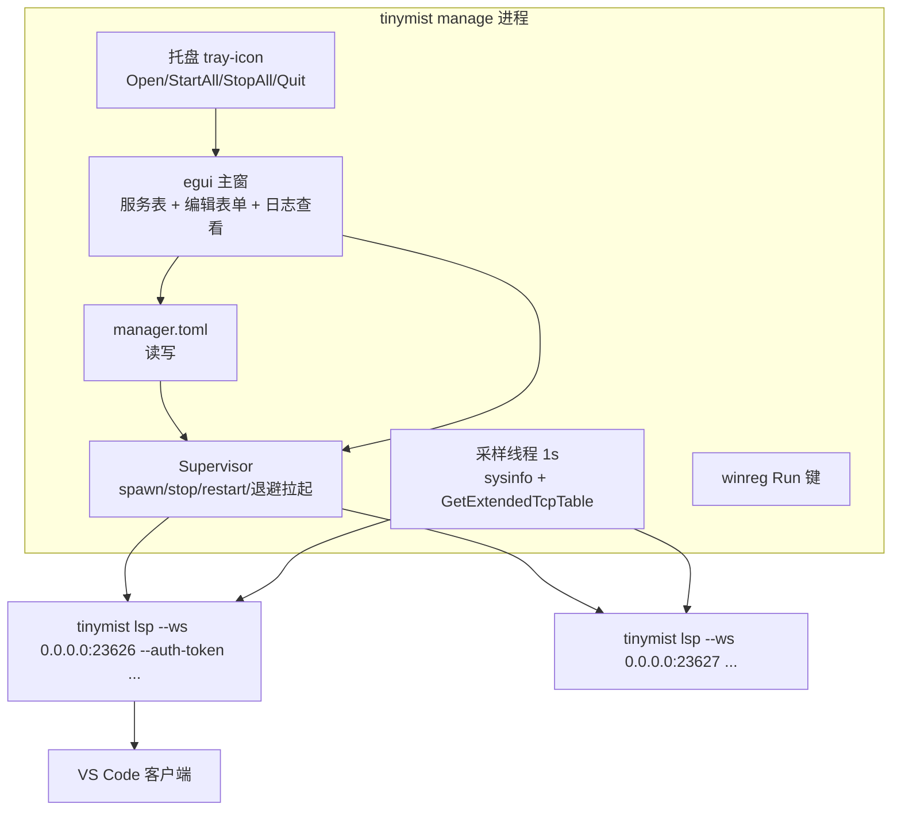

## 产品概述

为 tinymist 增加 Windows 桌面服务管理器：`tinymist manage` 子命令以系统托盘常驻，提供 egui 图形界面，统一管理多个 tinymist 语言服务实例（端口、token、字体路径），并展示资源占用与连接情况。

## 核心功能

- **托盘常驻与最小化**：启动后在系统托盘显示图标；关闭窗口即最小化到托盘；托盘菜单支持打开主窗、全部启动、全部停止、退出（退出前询问是否同时停止所有服务）。
- **服务管理**：图形界面内完成服务的增加、编辑、删除，配置项包括名称、传输方式（ws/tcp）、端口、token（支持显隐）、字体路径列表、开机自动启动勾选；配置持久化为 `%APPDATA%\tinymist\manager.toml`，首次运行生成默认条目（main / ws / 23626 / token=123456）。
- **启停控制**：每个服务支持 Start / Stop / Restart；支持全局 Start All / Stop All；服务异常退出时按退避策略自动拉起，手动停止不拉起。
- **状态展示**：服务表实时显示运行状态（Stopped/Starting/Running/Crashed）、PID、CPU 占用、内存占用、当前连接数；每行可查看该服务日志尾部。
- **开机自启**：一键开关，写注册表 `HKCU\...\Run` 键，`--minimized` 参数使开机后仅托盘运行。
- **单实例**：重复启动时唤起已有实例后退出。


## 技术栈

- Rust（新增全部为 crates.io 依赖，经本会话验证可直连拉取）：
  - GUI：`eframe`/`egui`（即时模式桌面 UI）
  - 托盘：`tray-icon`（Windows 原生实现，无系统依赖）
  - 进程信息：`sysinfo`（子进程 CPU/内存）
  - TCP 连接探测：`windows` crate（`GetExtendedTcpTable`）
  - 自启注册表：`winreg`；配置：`toml`（workspace 已有）
- Windows-only：所有依赖放 `[target.'cfg(windows)'.dependencies]`，代码放 `#[cfg(windows)]` 模块，保证 Linux CI 构建不受影响；feature 名 `manage`，加入 `default`。

## 架构



## 模块划分

- `cmd/manage/mod.rs`：子命令入口（`ManageArgs { minimized }`）、单实例互斥、初始化
- `cmd/manage/config.rs`：`ManagerConfig`/`ServiceConfig` TOML 读写、默认条目
- `cmd/manage/supervisor.rs`：子进程生命周期（spawn/stop/restart、退避、日志重定向与轮转）
- `cmd/manage/status.rs`：1s 采样线程（sysinfo CPU/内存、TCP 连接数），共享状态
- `cmd/manage/gui.rs`：服务表、Add/Edit 表单、日志查看窗
- `cmd/manage/tray.rs`：托盘菜单与事件、最小化行为
- `cmd/manage/autostart.rs`：注册表 Run 键读写

## 目录结构

```
crates/tinymist-cli/
├── Cargo.toml                      # [MODIFY] 新增 manage feature、Windows 依赖段、workspace 依赖声明（根 Cargo.toml 同步）
└── src/cmd/manage/                 # [NEW] 全部 #[cfg(windows)]
    ├── mod.rs                      # 入口、单实例互斥、运行事件循环
    ├── config.rs                   # TOML 配置模型与读写、默认条目
    ├── supervisor.rs               # 子进程管理、退避拉起、日志轮转
    ├── status.rs                   # CPU/内存/连接数采样
    ├── gui.rs                      # egui 服务表与编辑表单
    ├── tray.rs                     # 托盘与最小化
    └── autostart.rs                # 注册表开机自启
crates/tinymist-cli/src/main.rs     # [MODIFY] Commands 增加 Manage 分支与 verbose 分类
Cargo.toml                          # [MODIFY] workspace 依赖声明（eframe、tray-icon、sysinfo、winreg、windows）
Cargo.lock                          # [MODIFY] 自动更新
```

## 关键结构

```rust
/// 一个受管理的语言服务条目。
pub struct ServiceConfig {
    pub name: String,
    /// ws 或 tcp
    pub transport: Transport,
    pub port: u16,
    pub token: Option<String>,
    pub font_paths: Vec<PathBuf>,
    pub auto_start: bool,
}

/// 采样得到的服务运行时状态。
pub struct ServiceState {
    pub config: ServiceConfig,
    pub phase: ServicePhase,   // Stopped | Starting | Running | Crashed
    pub pid: Option<u32>,
    pub cpu_usage: f32,
    pub memory: u64,
    pub connections: usize,
}
```

## 实施注意

- `RUSTFLAGS='-Dwarnings'` 与 `missing_docs`：新模块公开项需文档注释，clippy 全绿。
- 子进程命令用 `current_exe()` 拼装，避免依赖 PATH；日志写入 `%APPDATA%\tinymist\logs\<name>.log`，超过 5MB 轮转为 `.old`。
- 手动 Stop 与崩溃区分：supervisor 内部用标志位控制是否拉起。
- 采样与 supervisor 跨线程共享用 `Arc<Mutex<>>` + `std::sync::mpsc`，GUI 通过 `ctx.request_repaint_after(1s)` 刷新，避免自绘线程阻塞。
- Quit 时「停止所有服务」的询问用 egui 模态确认，防止误杀正在服务的连接。
- 环境约束：本机 cargo 需 `CARGO_NET_GIT_FETCH_WITH_CLI=true` 与 `GIT_CONFIG_KEY_0=http.proxy=socks5h://127.0.0.1:10808`（typst 等 git 依赖走本地 SOCKS5 代理）。

