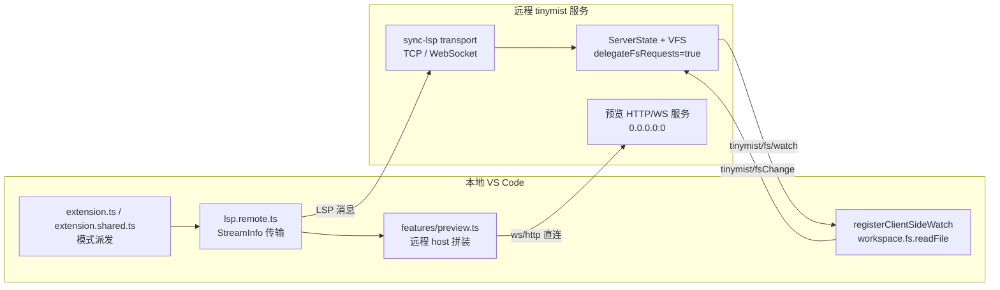

## 用户需求

把 VS Code 的 Tinymist 插件改造成可前后端分离的前端：语言服务（后端）部署在远程机器上，插件（前端）在本地运行并通过网络直连远程服务。

## 产品概述

插件激活后不再依赖本地 `tinymist` 可执行文件，而是按配置连接远程 `tinymist` 服务；工作区文件内容由前端按需回传给服务端，无需上传或复制整个工作区；预览面板可直接展示远程服务渲染的文档。

## 核心功能

- **远程连接模式**：在扩展设置中开启远程模式并填写服务端点（WebSocket 或 TCP），插件启动时直接连接该端点；未开启时保持原有的本地二进制启动行为不变。
- **连接状态与容错**：连接失败或断线时在界面给出清晰提示与“重试/查看日志”入口，重连后语言功能自动恢复。
- **核心语言能力可用**：远程模式下补全、诊断、跳转、悬停、格式化、代码操作等能力与本地模式表现一致。
- **按需文件回传**：服务端需要某个文件内容时向前端请求，前端从本地工作区读取后回传；编辑中的文档变更实时同步，不在内存中的被引用文件按需读取，不产生全量上传。
- **远程预览**：预览面板、浏览器预览均指向远程服务的实际地址，滚动同步与双向跳转仍可工作。
- **配置与降级**：新增远程相关设置项（端点、访问令牌、预览主机、路径映射）；远程模式下自动禁用依赖本地 CLI 的能力（如本地导出进程、开发工具链），并在界面说明原因。

## 技术栈

沿用现有栈，不引入新技术方向：

- 后端：Rust（`crates/sync-lsp` 传输层、`crates/tinymist-cli` 命令入口、`crates/tinymist` 服务状态与 VFS 委托）
- 前端：TypeScript（`vscode-languageclient` node 侧 `StreamInfo` 传输、`ws` 包、`net` 模块）
- 已有可复用依赖：`hyper-tungstenite = 0.19.0`（`preview` feature 已在默认构建中引入）、`tokio`（`crates/tinymist-cli/src/main.rs` 已有全局 runtime 单例 `RUNTIMES`）、`ws`（`src/features/preview-compat.ts:7` 已在用）

## 实现方案

### 总体策略

服务端复用既有「字节流 + `Content-Length` 分帧」模型，只需把 stdio 换成 socket：`sync_ls::transport::io_transport(kind, inp, out)` 已完全泛化，入参只要求 `BufRead` 与 `Write`，因此 TCP 直接用 `std::net::TcpStream` 的两个 clone 即可接入，无需重写协议层。WebSocket 通过一个「WS 消息 ⇄ LSP 字节流」适配器复用同一条路径。

前端在 `vscode-languageclient` 的 `ServerOptions` 里改成函数形式 `() => Promise<StreamInfo>`，返回 socket 的 `reader/writer`；WebSocket 用 `Duplex` 桥接 `ws` 与 `StreamMessageReader/Writer`，从而复用官方分帧解析，不再手写帧解析器。

文件回传不需要新增协议：`tinymist/fs/watch`（服务端请求）→ `vscode.workspace.fs.readFile`（前端读）→ `tinymist/fsChange`（前端回推）→ `ServerState::fs_change` 已构成完整闭环（`src/lsp.ts:486-601`、`crates/tinymist/src/input.rs:128-162`）。真正缺的只有两点：`config.delegateFsRequests` 被硬编码为 `false`（`src/extension.shared.ts:46`），以及 `WatchAccessModel::content()` 只注册 watch 就立刻返回 `FILE_MISSING_ERROR`（`crates/tinymist/src/input/watch.rs:112-119`），导致首次编译必然先失败一次。

预览侧服务端已返回完整 `static_server_addr`（`crates/tinymist/src/tool/preview.rs:549-554`），但前端三处写死 `127.0.0.1`（`preview.ts:444/517/573`），且拉起的预览服务绑在 `127.0.0.1:0`（`preview.ts:601`），远程不可达。

### 关键决策与权衡

1. **先 TCP 后 WebSocket，共用一套适配层**：TCP 零新增依赖，可最快打通链路并作为回归基线；WebSocket 更利于经反向代理/TLS Ingress 暴露，生产部署用它。二者都走 `io_transport`，只有「取到 `BufRead`/`Write`」的方式不同。
2. **新增独立 feature `remote-transport` 并纳入 default**：`hyper-tungstenite` 已被默认开启的 `preview` feature 引入，因此增量成本仅为少量代码与 `tokio/net`；纳入 default 可让发布产物开箱即用，避免用户拿到「不支持 --ws」的二进制。需按 `scripts/feature-testing.sh` 验证组合。
3. **单会话语义**：LSP 服务状态（`ServerState`、`entry_resolver`、编译缓存）绑定单个客户端，天然不适合多路复用。TCP/WS 均默认「接受一个连接、连接断开即退出进程」，交由部署侧（systemd/docker restart）拉起；避免引入共享状态改造。
4. **鉴权以令牌头为主**：WebSocket 在 upgrade 前校验 `Authorization: Bearer <token>`（`hyper_tungstenite::upgrade` 前可读 header）；TCP 在握手阶段读一行 `TINYMIST-AUTH <token>` 前置声明再交给 `io_transport`。令牌通过 `TINYMIST_AUTH_TOKEN` 环境变量注入，前端配置支持 `${env:...}` 替换（`src/config.ts:69-77` 已有该机制），避免明文落盘。
5. **预览地址由前端拼装而非新增服务端发现协议**：服务端返回端口即可，前端用远程端点的主机名拼接，避免修改 `StartPreviewResponse` 的既有契约；同时远程模式下把 `--data-plane-host` 从 `127.0.0.1:0` 改为 `0.0.0.0:0`，使端口对外可达。
6. **跨操作系统路径一致性**：服务端通过 `url_to_path` 把 URI 映射为本地路径，Windows 前端 + Linux 服务端时会出现 `/c:/...` 形态。首版以「路径空间一致」为默认前提，并提供可选 `tinymist.remote.pathMap`（前缀对）在 `fs/watch`、`fsChange`、预览跳转三处边界做转换；诊断 URI 是客户端 URI 的回显，无需映射。

### 性能与可靠性

- TCP 与 stdio 同为同步阻塞 IO，`io_transport` 已是独立的读/写线程 + 有界 channel（容量 0，天然背压），吞吐不会劣化；WebSocket 适配器在写侧做「按 `Content-Length` 聚合后发一条 WS 消息」，避免逐次 `write_all` 产生大量小帧。
- 文件回传按需触发，复杂度与实际被引用文件数线性相关；`WatchAccessModel` 需去重（现有 `watches: HashSet` 已去重），并注意 `content()` 不得无限等待，采用带上限的等待（建议 1s）后回退 `FILE_MISSING_ERROR`，由 `fsChange` 到达后重新调度。
- 连接失败走有限次指数退避重连，避免断网时刷爆日志与 CPU；日志复用现有 `outputChannel` 与 `log` crate，不打印令牌。

## 架构设计



组件职责：

- `sync-lsp`：只负责「字节流 ⇄ LSP 消息」，新增 TCP/WS 取流方式，不感知业务。
- `tinymist-cli`：参数解析与传输选择，保持 stdio 为默认分支（完全向后兼容）。
- `tinymist`：仅微调 `WatchAccessModel::content()` 的等待语义；`delegateFsRequests` 逻辑本身已就绪（`crates/tinymist/src/config.rs:908-921`）。
- `editors/vscode`：新增远程客户端工厂与配置派发，改动集中在 `extension.ts` / `extension.shared.ts` / `preview.ts`，`lsp.ts` 尽量不动。

## 目录结构

```
crates/
├── sync-lsp/
│   ├── Cargo.toml                      # [MODIFY] 新增 websocket feature 与可选依赖
│   └── src/
│       ├── transport.rs                # [MODIFY] 抽出 with_duplex_transport，新增 with_tcp_transport（TcpListener/TcpStream::try_clone/BufReader），支持 --auth-token 前置校验；连接断开时优雅结束
│       └── transport/
│           └── websocket.rs            # [NEW] WebSocket ⇄ LSP 字节流适配：Read 侧把 WS 消息重组成 Content-Length 帧，Write 侧聚合完整帧后单条发送；基于 hyper + hyper-tungstenite，复用现有 runtime
├── tinymist-cli/
│   ├── Cargo.toml                      # [MODIFY] 新增 remote-transport feature（hyper-tungstenite + tokio net/macros），并入 default
│   └── src/cmd/lsp.rs                  # [MODIFY] LspArgs 增加 --tcp / --ws / --ws-path / --auth-token；按参数选择 stdio/tcp/ws 分支，其余初始化逻辑复用
└── tinymist/
    └── src/input/watch.rs              # [MODIFY] WatchAccessModel::content 增加带上限的等待（共享 map + Condvar），fsChange 送达后唤醒并返回内容；超时回退 FILE_MISSING_ERROR 保持现有行为

editors/vscode/
├── package.json                        # [MODIFY] 新增 tinymist.remote.enabled / endpoint / token / previewHost / pathMap 配置项（nls 占位符）
├── src/
│   ├── lsp.remote.ts                   # [NEW] createRemoteLanguageClient：解析 tcp:// 与 ws:// 端点，返回 StreamInfo；WS 用 Duplex 桥接；连接失败/断开的重试与用户提示；注入 Authorization 头或 TCP 前置声明
│   ├── extension.ts                    # [MODIFY] LanguageState.Client 改为按配置派发：远程走 lsp.remote.ts，否则保持 createSystemLanguageClient
│   ├── extension.shared.ts             # [MODIFY] 远程模式跳过二进制探测；config.delegateFsRequests 置 true；置位 features.remote 以禁用依赖本地 CLI 的能力
│   ├── state.ts                        # [MODIFY] ExtensionState.features 增加 remote 标志
│   ├── config.ts                       # [MODIFY] TinymistConfig 增加 remote 字段；endpoint/token/previewHost 纳入变量替换
│   ├── features/remote-paths.ts        # [NEW] pathMap 前缀转换工具，供 fs/watch、fsChange、预览跳转三处复用
│   └── features/preview.ts             # [MODIFY] 远程模式传 --data-plane-host 0.0.0.0:0；localDataPlaneHost/externalDataPlaneHost/openExternal 与 HTML 中 127.0.0.1 均改用远程主机；远程模式不再触发服务端 open browser
├── locales/tinymist-vscode.toml        # [MODIFY] 新增配置项标题与描述的中英文条目
└── docs/tinymist/config/vscode.typ     # [MODIFY] 新增远程模式配置文档（Configuration.md 由脚本生成，禁止手改）
```

关键契约（新增传输入口签名，供实现对齐）：

```rust
// crates/sync-lsp/src/transport.rs
pub fn with_tcp_transport<M>(args: MirrorArgs, addr: std::net::SocketAddr, auth_token: Option<String>,
    f: impl FnOnce(Connection<M>) -> anyhow::Result<()>) -> anyhow::Result<()>
where M: TryFrom<Message, Error = anyhow::Error> + GetMessageKind;
```

```ts
// editors/vscode/src/lsp.remote.ts
export async function createRemoteLanguageClient(
  context: ExtensionContext,
  config: TinymistConfig,
  clientOptions: LanguageClientOptions,
): Promise<BaseLanguageClient>;
```

## 实施注意

- **向后兼容**：`tinymist lsp` 不带新参数时行为必须与当前完全一致（stdio 分支不加任何探测开销）；`LanguageState.Client` 的派发逻辑应让未配置远程的路径零行为差异。
- **本地 CLI 依赖**：`extension.shared.ts:198-255` 的 `makeExecCommand` 依赖本地可执行文件，远程模式下 `contextExt.tinymistExec` 不应被赋值；相关 feature（devKit、部分 task）需关闭或给出可理解提示，不要静默失败。
- **不要碰生成物**：`editors/vscode/Configuration.md`、`README.md` 等由 `node scripts/link-docs.mjs` 生成；本地化 JSON 由 `cd ../.. && yarn build:l10n` 生成。
- **警告即错误**：Rust 端满足 `RUSTFLAGS='-Dwarnings'`，`missing_docs` 需要为新增公开项补文档注释；`sync-lsp` 新增 feature 需在 `Cargo.toml` 中显式声明 `websocket = ["dep:hyper-tungstenite", ...]`，避免隐式依赖。
- **连接生命周期**：对端断开后读线程结束、channel 关闭，`ServerState` 必须能正常退出而不是挂起；实现时需验证「客户端直接杀进程」与「发送 `exit` 通知」两条路径。
- **安全**：令牌只在握手阶段出现，任何日志、错误消息、`outputChannel` 输出都不得包含令牌；预览端口对外暴露时默认仍绑定 `0.0.0.0` 属于用户显式选择的远程模式，需在文档中提示网络边界与鉴权建议。

## Agent Extensions

### SubAgent

- **code-explorer**
- Purpose: 在实现远程传输与预览地址改造前，核对所有 `127.0.0.1`、`dataPlanePort`、`fs/watch` 边界调用点，避免遗漏（例如 `preview-compat.ts` 中控制面的 `ws://127.0.0.1:${controlPlanePort}` 与 `translateExternalURL` 分支）。
- Expected outcome: 输出一份「需改造的远程地址/URI 边界清单」，与实现文件一一对应，确保没有残留写死本机地址或遗漏的路径映射入口。